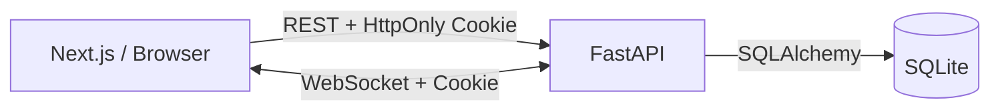
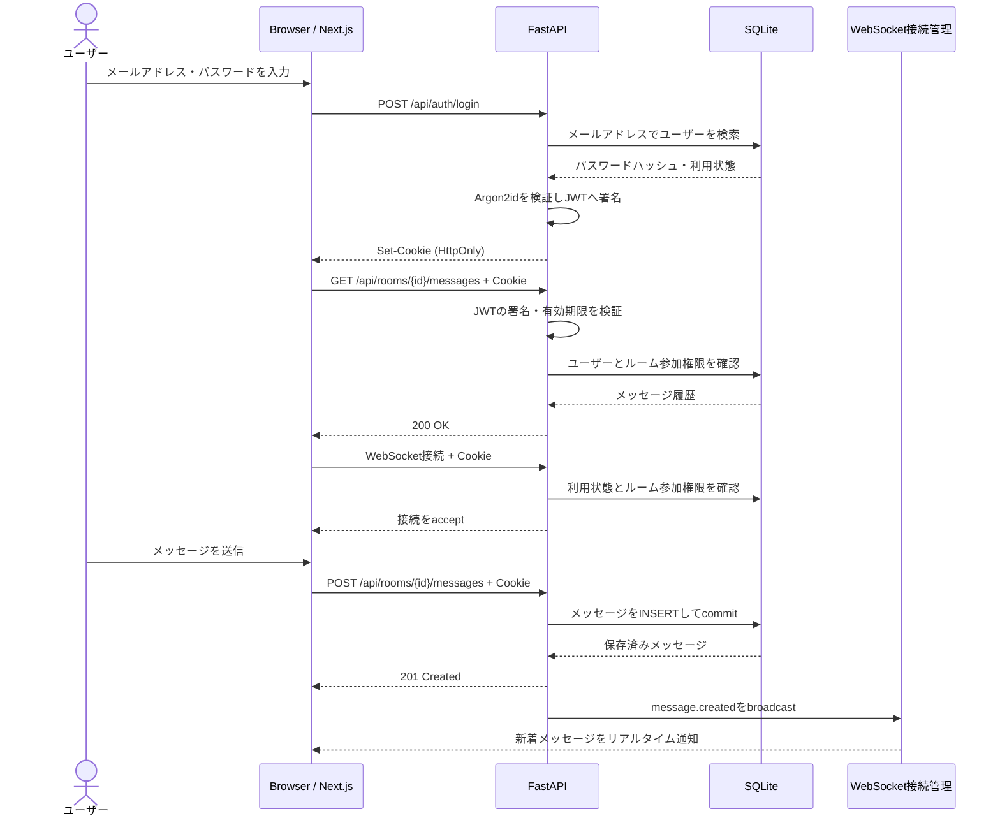
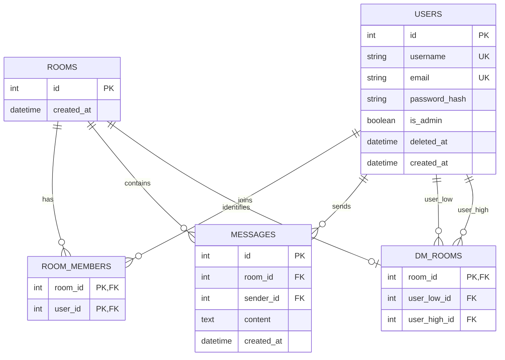

# 2WINS Chat

メールアドレスとパスワードでログインし、他のユーザーと1対1でリアルタイムに会話できるチャットアプリです。2WINSの技術テストとして、認証、ユーザー一覧、DMルーム、メッセージ履歴・送信、WebSocket、管理者による利用停止まで実装しました。

## 主な機能

- ユーザー名・メールアドレス・パスワードによる登録とログイン
- HttpOnly Cookieに保存した短時間JWTによる認証
- 自分以外の有効なユーザー一覧
- 2人の間で1つだけ作られるDMルーム
- ルーム参加者だけが行えるメッセージ取得・送信
- WebSocketによる新着メッセージのリアルタイム反映
- 切断時の自動再接続とメッセージ再同期
- 管理者によるユーザーのソフトデリート（利用停止）
- PC・スマートフォンに対応したUI

## 使用技術

| 分類 | 技術 |
| --- | --- |
| Frontend | Next.js 16 / React 19 / TypeScript |
| Backend | FastAPI / Pydantic v2 |
| ORM / DB | SQLAlchemy 2.x / SQLite / Alembic |
| Authentication | Argon2id（pwdlib）/ JWT（PyJWT） |
| Realtime | WebSocket |
| Test | pytest / FastAPI TestClient |
| Environment | Docker / Docker Compose |

## Dockerで起動する

Docker Desktopなど、Docker Composeを利用できる環境が必要です。

```bash
docker compose up --build
```

- アプリ: http://localhost:3000
- APIドキュメント: http://localhost:8000/docs

通常ユーザーは画面の「新規登録」から作成します。管理者は、コンテナを操作できる人だけが次のCLIで作成します。コマンド実行後にパスワードを2回入力します。

```bash
docker compose exec backend uv run --no-sync python -m app.commands.create_admin --username admin --email admin@example.com
```

停止は`docker compose down`です。SQLiteのデータは`chat_data` Volumeに残ります。`docker compose down -v`はユーザーとメッセージを含むデータを削除するため、初期化するときだけ使用してください。

Composeはローカル確認用の秘密鍵でも起動できます。共有環境では`.env.example`を`.env`へコピーし、`JWT_SECRET_KEY`を十分に長いランダム値へ必ず変更してください。

## ローカルで起動する

### Backend

Python 3.12と[uv](https://docs.astral.sh/uv/)を使用します。

```bash
cd backend
uv sync
uv run alembic upgrade head
uv run uvicorn app.main:app --reload --port 8000
```

管理者を作る場合は、Migration後に実行します。

```bash
uv run python -m app.commands.create_admin --username admin --email admin@example.com
```

### Frontend

Node.js 22を推奨します。別のターミナルで実行します。

```bash
cd frontend
npm ci
npm run dev
```

| 変数 | 用途 | ローカル既定値 |
| --- | --- | --- |
| `NEXT_PUBLIC_API_BASE_URL` | ブラウザから接続するAPI | `http://localhost:8000` |
| `NEXT_PUBLIC_WS_BASE_URL` | ブラウザから接続するWebSocket | `ws://localhost:8000` |
| `FRONTEND_ORIGINS` | API・WebSocketが許可するFrontend | `http://localhost:3000` |
| `DATABASE_URL` | SQLAlchemyの接続先 | `backend/chat.db` |
| `JWT_SECRET_KEY` | JWT署名用の秘密鍵 | 開発専用値 |
| `ACCESS_TOKEN_EXPIRE_MINUTES` | JWTの有効時間 | `60` |
| `AUTH_COOKIE_SECURE` | HTTPSだけにCookieを送るか | `false` |

本番のHTTPS環境では`AUTH_COOKIE_SECURE=true`にし、FrontendとAPIのURL・Originも実環境へ変更します。

## テスト

```bash
cd backend
uv run pytest
```

このプロジェクトでは、パスワードのハッシュ化とCookie、未認証アクセス拒否、ユーザー一覧、DMの一意性、ルーム外403、WebSocket通知とOrigin制限、管理権限、ソフトデリート後のログイン拒否をテストしています。一時SQLiteを使うため、開発用`chat.db`は変更しません。

Frontendは次で静的検査と本番ビルドを確認します。

```bash
cd frontend
npm run lint
npx tsc --noEmit
npm run build
```

今回は画面のE2Eテストを追加していません。画面が増える場合はPlaywrightなどで「登録→ログイン→DM送信→受信」の一連を追加する方針です。

## 全体構成



メッセージ送信はREST APIで検証・権限確認・保存を行い、コミット成功後にWebSocketで通知します。WebSocketだけで保存まで行わないことで、処理を1か所にまとめ、未保存メッセージの通知を避けています。

切断時は1秒、2秒、4秒、最大8秒と間隔を広げて再接続します。再接続後に履歴APIも取得するため、切断中の取りこぼしを補えます。DBを正しい状態の基準、WebSocketを素早い通知手段として扱っています。

## シーケンス図



## DB設計と理由

| テーブル | 役割 |
| --- | --- |
| `users` | 認証情報、管理権限、利用停止日時 |
| `rooms` | DM・将来のグループに共通する会話単位 |
| `room_members` | ルーム参加者とアクセス権限 |
| `dm_rooms` | DMの2人と`rooms`の対応 |
| `messages` | ルーム内のメッセージ |

`rooms`と`room_members`をDM専用情報から分け、メッセージを「DM」ではなく「ルーム」に所属させました。将来グループチャット機能を追加しても`messages`を作り直さず、グループ情報と参加者を追加できます。

`dm_rooms`では小さいユーザーIDを`user_low_id`、大きいIDを`user_high_id`へ保存します。このcanonical pairとUNIQUE制約により、Alice→BobとBob→Aliceを同じ組み合わせにし、同じ2人のDMが複数できることをDBでも防ぎます。

ユーザー削除は`deleted_at`を記録するソフトデリートです。ログイン、一覧、DM、WebSocketからは除外しますが、過去メッセージと参照整合性は残します。停止済みメールアドレスとユーザー名は監査・誤再利用防止のため予約されたままです。

## ER図



`dm_rooms(user_low_id, user_high_id)`には複合UNIQUE制約、`user_low_id < user_high_id`にはCHECK制約があります。

## Backendの分割

- `routers`: HTTPリクエスト、ステータスコード、レスポンスを扱う
- `services`: DM作成やメッセージ保存などのアプリ処理を扱う
- `dependencies.py`: JWTから現在ユーザーと管理権限を解決する
- `security.py`: パスワードとJWT、認証Cookieを扱う
- `schemas.py`: APIへ入る値・出る値をPydanticで検証する
- `models.py`: DBテーブルと制約をSQLAlchemyで表す
- `websocket.py`: 接続認証、接続管理、リアルタイム通知を扱う

HTTPの都合とチャットのルールを混ぜすぎないための分割です。一方、小規模課題なのでRepository層などの抽象化は増やしていません。

## 認証・管理者設計

認証フローはFastAPI内に実装しましたが、暗号処理そのものは自作していません。パスワードは`pwdlib`推奨設定のArgon2idで一方向ハッシュ化し、平文を保存・返却しません。

ログイン成功時は、ユーザーIDを`sub`、発行時刻を`iat`、有効期限を`exp`に持つJWTへサーバーが署名します。JWTは暗号化ではないため、秘密情報は入れません。ブラウザにはJavaScriptから読めないHttpOnly Cookieとして保存し、RESTとWebSocketの両方で同じCookieを検証します。`localStorage`や利用者指定のIDヘッダーは認証に使いません。

管理者は公開登録画面の「管理者コード」では作りません。コードの漏えい・総当たり・使い回しによる権限昇格を避け、サーバー操作権限を持つ人だけがCLIで作成します。画面表示だけでなく、管理APIでも`is_admin`を検証します。

## 意図的に残した制約

技術テストの規模と締切を考え、次は未実装であることを把握した上で残しています。

- JWTは60分のAccess Tokenのみで、Refresh Token、ローテーション、失効リストはありません。ログアウトはCookieを削除しますが、既に盗まれたJWT自体は期限まで失効しません。
- Cookieは`SameSite=Lax`、CORS、WebSocket Origin制限を使います。別サイト構成や高リスク操作を持つ実サービスではCSRF Tokenも追加します。
- ログイン試行のRate Limit、メール確認、パスワード再設定、MFAはありません。
- ソフトデリートの復元画面、個人情報の匿名化、保持期限はありません。実サービスでは運用・法的要件に合わせます。
- 認証追加前の開発DBにいた簡易ログインユーザーは履歴を残しつつログイン不能な値へMigrationします。必要なら新規登録し直します。
- SQLiteは小規模・単一サーバー向けです。同時書き込みが増えればPostgreSQLなどへ移行します。
- WebSocket接続はFastAPIプロセス内メモリで管理します。複数サーバー化ではRedis Pub/Subなどで通知を共有します。
- 履歴は全件取得です。増加時はメッセージID基準のページネーションを追加します。
- 友達申請とグループチャットは課題対象外です。ただしグループ追加時にメッセージ構造を作り直しにくいDB設計にしています。

## ディレクトリ構成

```text
.
├── backend/
│   ├── app/          # FastAPI、認証、SQLAlchemy、WebSocket
│   ├── alembic/      # DB Migration
│   └── tests/        # pytest
├── frontend/
│   ├── app/          # Next.js App Routerと画面
│   ├── components/   # フォーム、一覧、チャット
│   ├── lib/          # API接続設定と認証確認
│   └── types/        # APIレスポンスのTypeScript型と型ガード
└── compose.yaml
```
