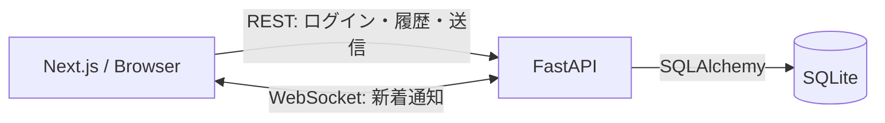

# 2WINS Chat

ユーザー名だけで入室し、他のユーザーと1対1でリアルタイムに会話できるチャットアプリです。2WINSの技術テストとして、ログイン、ユーザー一覧、DMルーム、メッセージ履歴・送信、WebSocketによるリアルタイム更新を実装しました。

## 主な機能

- ユーザー名による簡易ログイン
- 自分以外のユーザー一覧
- 2人の間で1つだけ作られるDMルーム
- ルーム参加者だけが行えるメッセージ取得・送信
- WebSocketによる新着メッセージのリアルタイム反映
- 切断時の自動再接続とメッセージ再同期
- PC・スマートフォンに対応したUI

## 使用技術

| 分類 | 技術 |
| --- | --- |
| Frontend | Next.js 16 / React 19 / TypeScript |
| Backend | FastAPI / Pydantic v2 |
| ORM | SQLAlchemy 2.x |
| Database | SQLite / Alembic |
| Realtime | WebSocket |
| Test | pytest / FastAPI TestClient |
| Environment | Docker / Docker Compose |

## Dockerで起動する

Docker Desktopなど、Docker Composeを利用できる環境が必要です。プロジェクトルートで次を実行します。

```bash
docker compose up --build
```

起動後、以下へアクセスできます。

- アプリ: http://localhost:3000
- APIドキュメント: http://localhost:8000/docs

停止する場合は次を実行します。

```bash
docker compose down
```

SQLiteのデータは`chat_data`というDocker Volumeに残ります。データも含めて初期化したい場合だけ`docker compose down -v`を使います。`-v`を付けると保存済みのユーザーやメッセージも削除されるため注意してください。

Dockerは動作環境を揃える用途に向いています。一方、WindowsやmacOSではファイル共有が遅くなる場合があるため、普段の開発は次のローカル起動の方が快適です。

## ローカルで起動する

### Backend

Python 3.12と[uv](https://docs.astral.sh/uv/)を使用します。

```bash
cd backend
uv sync
uv run alembic upgrade head
uv run uvicorn app.main:app --reload --port 8000
```

### Frontend

Node.js 22を推奨します。別のターミナルで実行します。

```bash
cd frontend
npm ci
npm run dev
```

通常は設定不要で、Frontendは`localhost:8000`のAPIへ接続します。ポートや接続先を変える場合は、各ディレクトリの`.env.example`を参考に環境変数を設定してください。

| 変数 | 用途 | 既定値 |
| --- | --- | --- |
| `NEXT_PUBLIC_API_BASE_URL` | ブラウザから接続するAPI | `http://localhost:8000` |
| `NEXT_PUBLIC_WS_BASE_URL` | ブラウザから接続するWebSocket | `ws://localhost:8000` |
| `FRONTEND_ORIGINS` | API・WebSocketが許可するFrontend | `http://localhost:3000` |
| `DATABASE_URL` | SQLAlchemyの接続先 | `backend/chat.db` |

## テスト

実務では、機能追加や修正によって既存機能が壊れていないことを短時間で確かめるために自動テストを使います。このプロジェクトでは、見た目の細部ではなく、チャットの重要なルールをテストしています。

```bash
cd backend
uv run pytest
```

現在のテスト対象は次のとおりです。

- 同じユーザー名でログインすると同じユーザーを返す
- ユーザー一覧から自分自身を除外する
- Alice→BobとBob→Aliceで同じDMルームを返す
- ルーム外のユーザーによるメッセージ取得を403にする
- 保存したメッセージをWebSocketでも通知する
- 許可していないOriginのWebSocket接続を拒否する

テストごとに一時的なSQLiteを作るため、開発用の`chat.db`は変更されません。

Frontendは次の静的検査と本番ビルドで確認します。

```bash
cd frontend
npm run lint
npx tsc --noEmit
npm run build
```

UIの自動操作テストは今回の規模では追加していません。実サービスとして画面が増える場合は、Playwrightなどで「ログインからメッセージ送信まで」のE2Eテストを追加する方針です。

## 全体構成



メッセージ送信はREST APIでDBへ保存し、コミットが成功した後にWebSocketで参加者へ通知します。WebSocketだけで保存まで行わないのは、入力検証、権限確認、DB処理をREST側の1か所にまとめ、保存前のメッセージが相手に見えることを避けるためです。

WebSocketが一時的に切れた場合は、1秒、2秒、4秒、最大8秒と間隔を広げながら再接続します。再接続後に履歴APIも取得するため、切断中に届かなかったメッセージを補えます。DBを正しい状態の基準とし、WebSocketは素早く通知するための仕組みとして扱っています。

## DB設計とその理由

| テーブル | 役割 |
| --- | --- |
| `users` | ユーザー名と作成日時 |
| `rooms` | DM・将来のグループに共通する会話の単位 |
| `room_members` | ルームの参加者とアクセス権限 |
| `dm_rooms` | DMに参加する2人と`rooms`の対応 |
| `messages` | ルーム内のメッセージ |

DM専用テーブルへすべてをまとめず、`rooms`と`room_members`を分けたのは、メッセージを「DMのもの」ではなく「ルームのもの」として扱うためです。将来グループチャットを追加する場合も、`messages`の構造を変えず、グループ情報のテーブルと`room_members`の参加者を追加できます。

`dm_rooms`では、小さいユーザーIDを`user_low_id`、大きいIDを`user_high_id`へ保存します。このcanonical pairとUNIQUE制約によって、Alice→BobとBob→Aliceを同じ組み合わせとして扱い、同じ2人のDMが複数作られることをDBでも防いでいます。

## Backendの分割

- `routers`: HTTPリクエストを受け、入力とレスポンスを扱う
- `services`: DM作成やメッセージ保存など、アプリの処理をまとめる
- `schemas.py`: APIへ入る値・出る値をPydanticで検証する
- `models.py`: DBテーブルと制約をSQLAlchemyで表す
- `websocket.py`: 接続管理とリアルタイム通知を扱う

RouterからDB処理を分けることで、HTTPの都合とチャットのルールを混ぜすぎないようにしました。今後、同じDM作成処理を別のAPIから呼ぶ場合や、処理だけをテストする場合にも再利用しやすくなります。ただし小規模な課題なので、必要以上にクラスや抽象化は増やしていません。

## セキュリティと意図的に残した制約

### 簡易ログイン

このアプリは課題要件の「ユーザー名だけの簡易ログイン」に合わせ、パスワードや本物のセッションを実装していません。同じユーザー名を入力すると同じユーザーを返し、FrontendがユーザーIDを`localStorage`へ保存して`X-User-Id`ヘッダーで送ります。

そのため、`localStorage`やヘッダーを書き換えると他のユーザーになりすませます。これは気付かず残したものではなく、課題の範囲と開発時間を考えて意図的に簡易認証のままにした制約です。実サービスでは、パスワードなどで本人確認を行い、サーバー側セッションをHttpOnly Cookieで管理します。WebSocketにもログインセッションと結び付いた短時間有効なトークンを使います。

現在も、ルーム参加者以外の取得・送信を403にすること、Pydanticによる文字数・余分な項目の検証、CORSとWebSocket Originの制限、セキュリティヘッダーの付与は行っています。ただし、これらは本物の本人確認の代わりにはなりません。

### 現在の構成上の限界

- SQLiteは小規模・単一サーバーには扱いやすい一方、大量の同時書き込みには向きません。規模が大きくなればPostgreSQLなどへ移行します。
- WebSocket接続はFastAPIプロセス内のメモリで管理しています。複数サーバーへ増やす場合は、Redis Pub/Subなどを間に置いて通知を共有します。
- メッセージ履歴は現在すべて取得します。履歴が増える実サービスでは、メッセージIDを基準にしたページネーションを追加します。
- 友達申請とグループチャットは課題対象外なので実装していません。ただし、グループ追加時にメッセージ構造を作り直さないDB構成にしています。
- ローカル実行ではHTTP・WSを使います。本番環境ではHTTPS・WSSを使用し、秘密情報は環境変数やSecret Managerで管理します。

## ディレクトリ構成

```text
.
├── backend/
│   ├── app/          # FastAPI、SQLAlchemy、WebSocket
│   ├── alembic/      # DB migration
│   └── tests/        # pytest
├── frontend/
│   ├── app/          # Next.js App Router
│   ├── components/   # 画面部品
│   ├── lib/          # 設定・保存ユーザー処理
│   └── types/        # APIレスポンスのTypeScript型
└── compose.yaml
```
