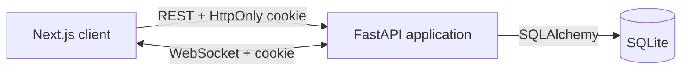
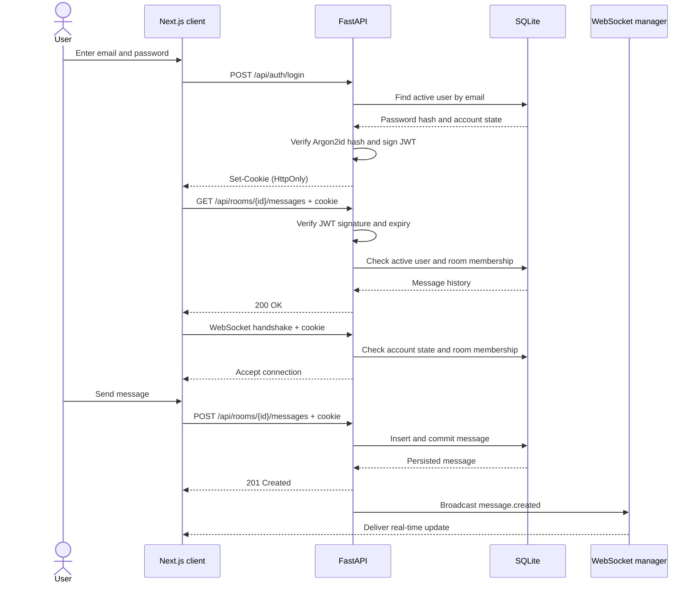
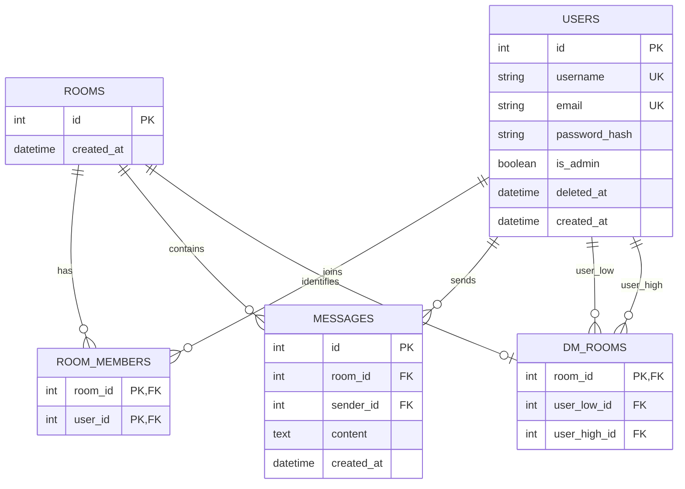

# Relay

Relay is a full-stack, one-to-one messaging app with secure cookie-based authentication and real-time delivery. It combines a Next.js client with a FastAPI API, a relational chat model, and WebSocket updates while keeping the database as the source of truth.

## Highlights

- Account registration and sign-in with username, email, and password
- Argon2id password hashing and short-lived JWT authentication in an HttpOnly cookie
- A list of active users excluding the signed-in account
- Exactly one direct-message room for each pair of users
- Participant-only access to message history and message creation
- Real-time delivery over authenticated WebSocket connections
- Automatic reconnection with exponential backoff and history synchronization
- Admin-only account deactivation using soft deletion
- Responsive UI for desktop and mobile browsers

## Tech stack

| Area | Technology |
| --- | --- |
| Frontend | Next.js 16, React 19, TypeScript |
| Backend | FastAPI, Pydantic v2 |
| Data | SQLAlchemy 2.x, SQLite, Alembic |
| Authentication | Argon2id via pwdlib, JWT via PyJWT |
| Real-time transport | WebSocket |
| Testing | pytest, FastAPI TestClient |
| Development | Docker, Docker Compose |

## Try Relay locally

Docker Desktop or another Docker Compose environment is required.

```bash
docker compose up --build
```

Then open:

- Web app: <http://localhost:3000>
- Interactive API documentation: <http://localhost:8000/docs>

For a quick real-time demo:

1. Register one account in your regular browser window.
2. Register a second account in a private window or another browser.
3. Select the other account from the **People** list.
4. Send messages from both windows and watch them appear in real time.

Create regular users from the registration page. To create an administrator, run the following command and enter the password twice when prompted:

```bash
docker compose exec backend uv run --no-sync python -m app.commands.create_admin --username admin --email admin@example.com
```

Stop the app with `docker compose down`. SQLite data remains in the `chat_data` volume. Use `docker compose down -v` only when you intentionally want to delete all users and messages.

Docker Compose includes a development signing secret so the project starts without extra setup. Before sharing or deploying the app, copy `.env.example` to `.env` and replace `JWT_SECRET_KEY` with a long random value.

## Architecture



Message writes go through the REST API, where the server validates input, checks room membership, and commits the message. Only after a successful commit does the server broadcast a `message.created` event over WebSocket. This keeps persistence in one code path and prevents clients from seeing messages that were never saved.

When a WebSocket disconnects, the client retries after 1, 2, 4, and then at most 8 seconds. It fetches message history again after reconnecting, so messages sent during the interruption are recovered. The database is the source of truth; WebSocket is the low-latency notification channel.

### Sign-in and messaging sequence



## Data model and design choices

| Table | Responsibility |
| --- | --- |
| `users` | Authentication data, administrator role, and deactivation time |
| `rooms` | Conversation identity shared by DMs and possible future group chats |
| `room_members` | Room membership and authorization boundary |
| `dm_rooms` | Mapping between a room and its two DM participants |
| `messages` | Messages belonging to a room |



Messages belong to a general-purpose `room`, not directly to a DM. Separating `rooms` and `room_members` from `dm_rooms` means group chat metadata can be added later without rebuilding the message model.

For a DM, the lower user ID is always stored as `user_low_id` and the higher ID as `user_high_id`. This canonical pair has a composite `UNIQUE` constraint, so Alice-to-Bob and Bob-to-Alice resolve to the same room. A `CHECK` constraint also enforces `user_low_id < user_high_id`.

Account deletion is implemented as deactivation by setting `deleted_at`. Deactivated users are excluded from sign-in, user discovery, DM creation, and WebSocket access, while historical messages and referential integrity remain intact. Their username and email stay reserved to avoid accidental identity reuse.

## Backend organization

- `routers` handles HTTP input, status codes, and response schemas.
- `services` contains application operations such as creating DMs and saving messages.
- `dependencies.py` resolves the current user and administrator authorization from the JWT.
- `security.py` handles password hashing, JWTs, and the authentication cookie.
- `schemas.py` validates API input and output with Pydantic.
- `models.py` defines SQLAlchemy tables, relationships, and database constraints.
- `websocket.py` authenticates connections, tracks clients, and broadcasts events.

This keeps HTTP concerns separate from chat rules without adding extra repository abstractions that would provide little value at the current scale.

## Authentication and security

Relay implements the authentication flow inside FastAPI but delegates cryptography to maintained libraries. Passwords are one-way hashed with pwdlib's recommended Argon2id configuration and are never stored or returned as plaintext.

After a successful login, the server signs a JWT containing the user ID in `sub`, the issued time in `iat`, and the expiry in `exp`. A JWT is signed, not encrypted, so it contains no secrets. The browser receives it in an HttpOnly cookie that JavaScript cannot read. REST endpoints and WebSocket handshakes validate the same cookie; client-provided user IDs and `localStorage` are not trusted for authentication.

Administrators are created through a server-side CLI rather than a public registration code. This avoids privilege escalation through leaked, reused, or brute-forced codes. Authorization is enforced by the admin API as well as by the UI.

## Run without Docker

### Backend

Python 3.12 and [uv](https://docs.astral.sh/uv/) are recommended.

```bash
cd backend
uv sync
uv run alembic upgrade head
uv run uvicorn app.main:app --reload --port 8000
```

To create an administrator after applying migrations:

```bash
uv run python -m app.commands.create_admin --username admin --email admin@example.com
```

### Frontend

Node.js 22 is recommended. Run these commands in a separate terminal:

```bash
cd frontend
npm ci
npm run dev
```

### Environment variables

| Variable | Purpose | Local default |
| --- | --- | --- |
| `NEXT_PUBLIC_API_BASE_URL` | API URL used by the browser | `http://localhost:8000` |
| `NEXT_PUBLIC_WS_BASE_URL` | WebSocket URL used by the browser | `ws://localhost:8000` |
| `FRONTEND_ORIGINS` | Frontend origins allowed by REST and WebSocket | `http://localhost:3000` |
| `DATABASE_URL` | SQLAlchemy database URL | `backend/chat.db` |
| `JWT_SECRET_KEY` | Secret used to sign JWTs | Development-only value |
| `ACCESS_TOKEN_EXPIRE_MINUTES` | JWT lifetime in minutes | `60` |
| `AUTH_COOKIE_SECURE` | Restrict the cookie to HTTPS | `false` |

Set `AUTH_COOKIE_SECURE=true` in an HTTPS environment and replace all local URLs and allowed origins with their deployed values.

## Tests and checks

Run the backend test suite:

```bash
cd backend
uv run pytest
```

The suite covers password hashing and cookies, unauthenticated access, user discovery, DM uniqueness, non-member authorization, WebSocket delivery and origin restrictions, admin authorization, and sign-in rejection after account deactivation. Tests use a temporary SQLite database and never modify the development database.

Run frontend static checks and a production build:

```bash
cd frontend
npm run lint
npx tsc --noEmit
npm run build
```

## Current scope and production considerations

- Authentication uses a 60-minute access token without refresh-token rotation or a revocation list. Signing out removes the cookie, but a stolen token remains valid until it expires.
- `SameSite=Lax`, CORS restrictions, and WebSocket origin checks protect the current same-site setup. A cross-site production architecture would also require an explicit CSRF strategy and different cookie settings.
- Rate limiting, email verification, password reset, and multi-factor authentication are not implemented.
- Deactivated accounts do not yet have restoration, anonymization, or retention workflows.
- SQLite is appropriate for this small, single-server project. A write-heavy or multi-instance deployment should use PostgreSQL or another server database.
- WebSocket connections are tracked in one FastAPI process. Multiple backend instances would require shared fan-out such as Redis Pub/Sub.
- Message history is loaded in full. Cursor pagination by message ID should be added as conversations grow.
- End-to-end browser tests are not included yet. A Playwright flow covering registration, login, DM creation, sending, and receiving would be the next testing layer.
- Group chat is outside the current scope, but the room-based data model is designed to add it without replacing the message table.

## Project structure

```text
.
├── backend/
│   ├── app/          # FastAPI, authentication, SQLAlchemy, and WebSocket code
│   ├── alembic/      # Database migrations
│   └── tests/        # pytest suite
├── frontend/
│   ├── app/          # Next.js App Router pages
│   ├── components/   # Forms, user list, and chat UI
│   ├── lib/          # API configuration and authentication helpers
│   └── types/        # TypeScript API types and runtime type guards
└── compose.yaml
```
